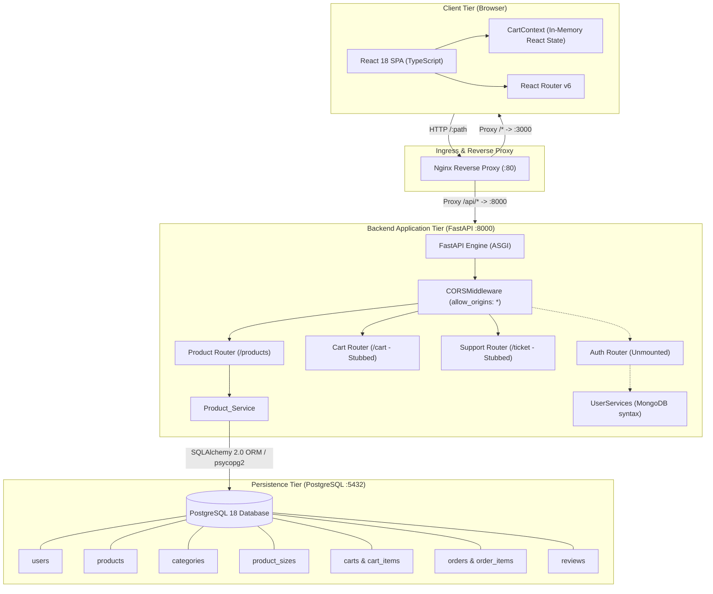
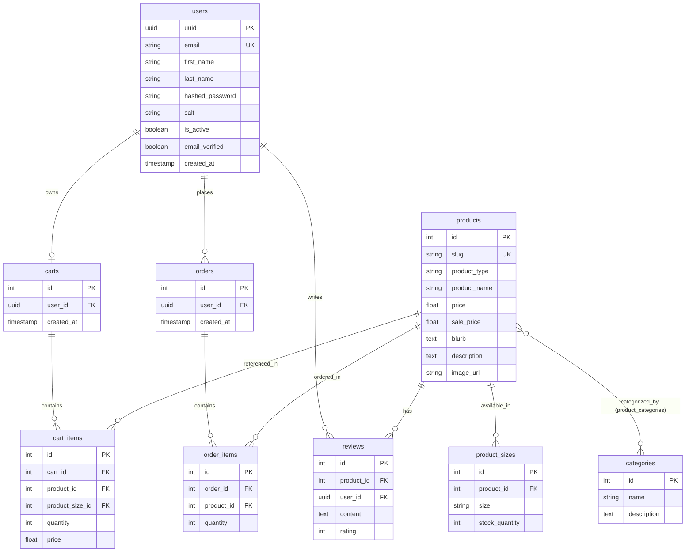
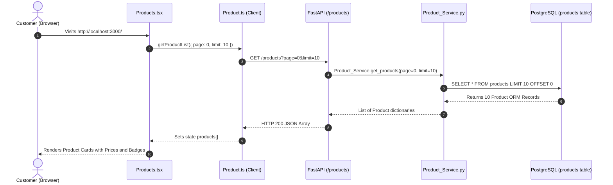
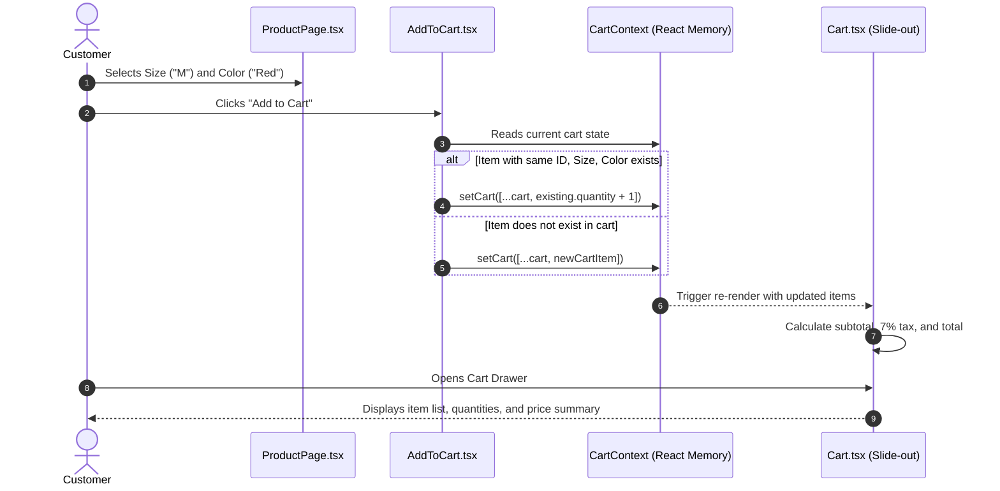

# ShopMate AI — System Architecture & Technical Specifications

**Document:** Architecture Specification & Engineering Topology  
**Role:** Senior Forward Deployed Engineer (FDE)  
**Target System:** ShopMate AI Platform  

---

## 1. High-Level Architecture Diagram

The system operates across four primary tiers: Client, Ingress / Gateway, Backend Services, and Persistence.



---

## 2. Component Architecture

### 2.1 Client Tier
* **State Management:** Handled via React Context API (`CartContext`) defined in [App.tsx](file:///c:/Users/saura/ShopMate-AI/frontend/src/App.tsx). Shopping cart state is transient and resides in browser memory.
* **Navigation & Routing:** React Router v6 provides client-side routing across `/` (catalog), `/products/:productID` (details), `/login`, and `/register`.
* **Design System:** Hybrid setup with Tailwind CSS utility classes and Material UI (MUI v5) atomic components (Buttons, Drawers, Cards, Badges).

### 2.2 Reverse Proxy & Ingress Tier
* Defined in [nginx/default.conf](file:///c:/Users/saura/ShopMate-AI/nginx/default.conf):
  * Exposes port `80`.
  * Routes `/api` to backend upstream `http://backend:8000`.
  * Routes `/` to frontend upstream `http://frontend:3000`.
* In local development, the frontend dev server runs directly on port `3000` and proxies REST requests to `http://localhost:8000`.

### 2.3 Application Tier (FastAPI)
* **ASGI Framework:** FastAPI with asynchronous ASGI request processing.
* **Data Serialization:** Pydantic models validate input and output payloads (`ProductResponse`, `CartBase`, `UserCreate`).
* **Router Registration:** [backend/app/app.py](file:///c:/Users/saura/ShopMate-AI/backend/app/app.py) mounts `product_router`, `cart_router`, and `support_router` under `root_path="/api"`.

### 2.4 Persistence Tier
* **Engine:** PostgreSQL 16/18 with relational integrity enforced via primary keys, unique constraints, and foreign key cascades.
* **ORM:** SQLAlchemy 2.0 declarative base (`Base = declarative_base()`) in [backend/app/db/\_\_init\_\_.py](file:///c:/Users/saura/ShopMate-AI/backend/app/db/__init__.py).
* **Connection Lifecycle:** Currently instantiates a single static session `db = get_db_session()` in service modules.

---

## 3. Entity-Relationship (ER) Diagram



---

## 4. Request-Response Sequence Diagrams

### 4.1 Product Catalog Discovery Flow


### 4.2 Client-Side Shopping Cart Addition


---

## 5. Critical Architectural Limitations & Technical Debt

### 5.1 Broken Authentication Service
* **Issue:** [backend/app/services/user_service.py](file:///c:/Users/saura/ShopMate-AI/backend/app/services/user_service.py) contains MongoDB ODM method invocations (`await User.find_one(...)`, `await user_obj.insert()`). When called against the PostgreSQL SQLAlchemy `User` model, this throws fatal exceptions.
* **Routing Issue:** [backend/app/routers/auth_router.py](file:///c:/Users/saura/ShopMate-AI/backend/app/routers/auth_router.py) is completely omitted from router mounting in [backend/app/app.py](file:///c:/Users/saura/ShopMate-AI/backend/app/app.py).

### 5.2 Server-Side Cart Implementation Void
* **Issue:** All endpoints in [backend/app/routers/cart_router.py](file:///c:/Users/saura/ShopMate-AI/backend/app/routers/cart_router.py) consist of `pass` statements. The database tables `carts` and `cart_items` are never written to or queried during regular web store operations.
* **Impact on AI Assistant:** An AI agent cannot inspect or modify a user's cart on the server side until a persistent cart repository and REST/GraphQL interface is established.

### 5.3 Primary Key Query Bug in Product Service
* **Issue:** In [backend/app/services/product_service.py](file:///c:/Users/saura/ShopMate-AI/backend/app/services/product_service.py) lines 59 and 71:
  ```python
  db_product = db.query(Product).get(product_slug)
  ```
  In SQLAlchemy, `.get()` accepts the model's primary key (`Product.id`, an `int`), but `product_slug` (`str`) is passed. This fails when attempting product updates or deletions. It must query `filter(Product.slug == product_slug).first()`.

### 5.4 Database Session Management Anti-Pattern
* **Issue:** Services import a static module-level session (`db = get_db_session()`).
* **Consequence:** Requests share an unmanaged connection. If any query fails, `db.rollback()` must be executed cleanly, or subsequent operations in the thread can fail with transaction abort errors. Best practice requires FastAPI's `Depends(get_db)` yielding session context per request.

### 5.5 Absence of Native Search & Filter Engine
* **Issue:** No backend search endpoint exists.
* **Impact on AI Assistant:** An AI assistant requires granular search capabilities (e.g., query by keyword, category, price range, sizing availability). Currently, the agent would have to pull all products into memory to filter them.

---

## 6. Security Assessment & Threat Modeling

1. **Hardcoded JWT Secret Key:**  
   `SECRET_KEY = "your_secret_key"` in [user_service.py](file:///c:/Users/saura/ShopMate-AI/backend/app/services/user_service.py#L13). Must be moved to environment variables (`os.getenv("JWT_SECRET_KEY")`).
2. **Excessive CORS Scope:**  
   `allow_origins=["*"]` with `allow_credentials=True` in [backend/app/app.py](file:///c:/Users/saura/ShopMate-AI/backend/app/app.py#L38) violates modern browser security policies and enables cross-origin resource access.
3. **Unprotected Mutating Routes:**  
   Endpoints such as `POST /products`, `PUT /products`, and `DELETE /products` lack Role-Based Access Control (RBAC) or admin authentication guards.
4. **Volatile Client-Controlled Cart:**  
   Prices and quantities are calculated purely on the client side. Any client can alter prices before submitting without server-side validation.
