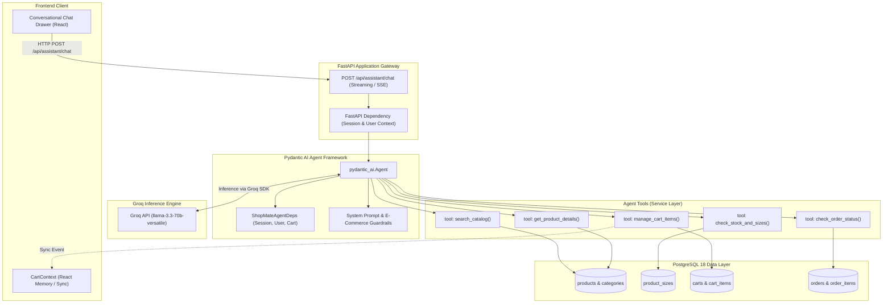
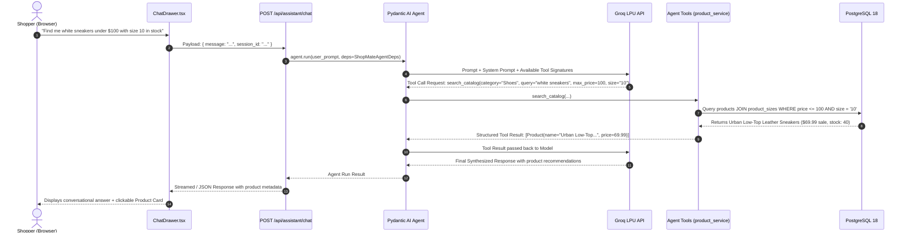

# ShopMate AI — Enterprise AI Integration Plan

**Document:** Pydantic AI & Groq Shopping Assistant Integration Blueprint  
**Role:** Senior Forward Deployed Engineer (FDE)  
**Target:** Modernization of ShopMate AI with Conversational Intelligence  

---

## 1. Executive Summary & Integration Mission

The objective is to integrate an enterprise-grade conversational shopping assistant into the ShopMate AI platform. Powered by **Pydantic AI** and accelerated by **Groq's LPU inference engine**, the assistant will provide:
1. **Natural Language Product Discovery:** Semantic search, style recommendations, and cross-category discovery.
2. **Real-time Inventory & Sizing Inquiries:** Direct queries into `product_sizes` stock levels.
3. **Conversational Cart Operations:** Natural language addition, modification, and review of cart items.
4. **Order Status & Tracking Assistance:** Answering inquiries regarding past customer orders.

---

## 2. Integration Architecture & Agent Topology



---

## 3. Reusable Services & Agent Tools Inventory

Pydantic AI enables type-safe tool execution using Python type hints and Pydantic validation schemas. Below are the designated tools to wrap around existing and modernized service layers:

### Tool 1: `search_catalog`
* **Purpose:** Searches products by query keyword, category name, minimum/maximum price, or specific size.
* **Target Service:** Extends `backend/app/services/product_service.py` (`Product_Service`).
* **Input Schema:**
  ```python
  from pydantic import BaseModel, Field
  from typing import Optional

  class SearchCatalogParams(BaseModel):
      query: Optional[str] = Field(None, description="Keywords matching product name or description")
      category: Optional[str] = Field(None, description="Category name (e.g. Tops, Bottoms, Shoes, Accessories)")
      max_price: Optional[float] = Field(None, description="Maximum price filter in USD")
      min_price: Optional[float] = Field(None, description="Minimum price filter in USD")
      size: Optional[str] = Field(None, description="Specific clothing/shoe size (e.g. S, M, L, 9, 10)")
  ```

### Tool 2: `get_product_details`
* **Purpose:** Retrieves deep specifications, descriptions, review summaries, and sale discounts for a specific product.
* **Target Service:** Reuses `Product_Service.get_product(product_slug)` in [product_service.py](file:///c:/Users/saura/ShopMate-AI/backend/app/services/product_service.py#L48).
* **Input Schema:**
  ```python
  class ProductDetailsParams(BaseModel):
      product_slug: str = Field(..., description="The unique slug handle of the product (e.g. 'classic-white-sneakers')")
  ```

### Tool 3: `check_stock_and_sizes`
* **Purpose:** Validates live inventory quantities for a product across all available sizes before recommending or adding to cart.
* **Target Service:** Direct query to `ProductSize` ORM model in [backend/app/models/sqlalchemy/product.py](file:///c:/Users/saura/ShopMate-AI/backend/app/models/sqlalchemy/product.py#L26).
* **Input Schema:**
  ```python
  class StockCheckParams(BaseModel):
      product_slug: str = Field(..., description="Unique slug of the product")
      size: Optional[str] = Field(None, description="Specific size to verify (e.g. 'M', '10')")
  ```

### Tool 4: `manage_cart_items`
* **Purpose:** Enables the assistant to add products, adjust quantities, or remove items from the customer's cart on their behalf.
* **Target Service:** Wraps the completed `CartService` interacting with `carts` and `cart_items` in [cart.py](file:///c:/Users/saura/ShopMate-AI/backend/app/models/sqlalchemy/cart.py).
* **Input Schema:**
  ```python
  from typing import Literal

  class CartManageParams(BaseModel):
      action: Literal["add", "remove", "update", "view"] = Field(..., description="Cart operation to perform")
      product_slug: Optional[str] = Field(None, description="Product slug to manipulate")
      size: Optional[str] = Field(None, description="Selected size (required for add)")
      quantity: int = Field(1, description="Quantity to set or add")
  ```

### Tool 5: `check_order_status`
* **Purpose:** Queries customer order status, item breakdown, and timestamps.
* **Target Service:** Wraps `Order` and `OrderItem` ORM models in [order.py](file:///c:/Users/saura/ShopMate-AI/backend/app/models/sqlalchemy/order.py).
* **Input Schema:**
  ```python
  class OrderStatusParams(BaseModel):
      order_id: int = Field(..., description="Numeric order identifier")
  ```

---

## 4. Exact Integration Points in Codebase

### 4.1 Backend Integration Files (Target Directory: `backend/app/ai/`)
1. **`backend/app/ai/deps.py`**
   * Declares `ShopMateAgentDeps` dataclass containing:
     * `db_session: Session` (SQLAlchemy per-request session).
     * `user_id: Optional[UUID]` (Authenticated customer or anonymous session).
     * `cart_id: Optional[int]` (Active shopping cart).
2. **`backend/app/ai/tools.py`**
   * Encapsulates the 5 type-safe tool functions decorated with `@agent.tool`.
3. **`backend/app/ai/agent.py`**
   * Instantiates `pydantic_ai.Agent('groq:llama-3.3-70b-versatile', deps_type=ShopMateAgentDeps, ...)`.
   * Defines system instructions, tone, and e-commerce guardrails.
4. **`backend/app/routers/assistant_router.py`**
   * New FastAPI APIRouter mounted in [backend/app/app.py](file:///c:/Users/saura/ShopMate-AI/backend/app/app.py):
     ```python
     POST /api/assistant/chat
     ```
   * Supports streaming token responses (Server-Sent Events) or structured JSON turn completions.

### 4.2 Frontend Integration Points (Target: `frontend/src/components/assistant/`)
1. **`frontend/src/components/assistant/ChatWidget.tsx`**
   * Floating action button on bottom-right of the viewport.
2. **`frontend/src/components/assistant/ChatDrawer.tsx`**
   * Slide-out chat window (integrated with MUI Drawer or custom floating card).
   * Displays conversational message thread, quick-suggestion chips ("Show me sneakers on sale", "What goes with denim jackets?").
   * Renders embedded interactive product pills that navigate directly to `/products/:productID`.
3. **`frontend/src/context/CartContext.tsx` Hook**
   * Listens for assistant cart tool mutations to update the top-bar cart badge in real-time.

---

## 5. Architectural Challenges & Mitigation Strategies

| Challenge | Architectural Risk | Senior FDE Mitigation Strategy |
| :--- | :--- | :--- |
| **Session Concurrency** | Global `db = get_db_session()` in services causes transaction collisions during concurrent AI tool calls. | Refactor services to accept an active SQLAlchemy `Session` passed via Pydantic AI's `RunContext[ShopMateAgentDeps]`. |
| **Volatile Client Cart** | Frontend cart lives in browser memory, while AI agent runs on the backend. | Implement a lightweight backend Cart sync endpoint (`POST /api/cart/sync`) so client-side and agent cart state remain consistent. |
| **LLM Hallucinations** | Agent might invent non-existent products, fictitious discounts, or fake stock. | Enforce Pydantic validation on tool responses; system prompt strictly forbids stating a product is in stock without a verifying tool call. |
| **Groq Rate Limits** | High token throughput on conversational turns exceeding Groq TPM/RPM limits. | Utilize Groq's high-throughput `llama-3.3-70b-versatile` model with concise tool outputs, conversation trimming, and backoff retry logic. |
| **SQL Injection via Agent** | Free-form natural language input into database queries. | All tool queries must use SQLAlchemy parameterized queries and ORM filters—never raw string SQL concatenation. |

---

## 6. End-to-End Sequence Flow



---

## 7. Recommended Phased Implementation Sequence

To prepare this codebase cleanly for the Pydantic AI shopping assistant, follow this exact engineering sequence:

```
┌─────────────────────────────────────────────────────────────┐
│ Phase 1: Database & Backend Service Foundation              │
│ - Refactor get_db_session() to FastAPI Depends(get_db)      │
│ - Implement server-side CartService & sync endpoint         │
│ - Fix Product_Service.update/delete primary key bug         │
│ - Mount auth_router with proper SQLAlchemy ORM handlers     │
└──────────────────────────────┬──────────────────────────────┘
                               │
                               ▼
┌─────────────────────────────────────────────────────────────┐
│ Phase 2: Agent Tools Layer Development                      │
│ - Create backend/app/ai/schemas.py (Pydantic tool schemas)  │
│ - Implement enhanced search_catalog with filter support     │
│ - Build check_stock_and_sizes and manage_cart tools         │
│ - Write automated unit tests for each tool function         │
└──────────────────────────────┬──────────────────────────────┘
                               │
                               ▼
┌─────────────────────────────────────────────────────────────┐
│ Phase 3: Pydantic AI & Groq Core Integration                │
│ - Install pydantic-ai and groq dependencies                 │
│ - Configure GROQ_API_KEY in backend/.env                    │
│ - Initialize Pydantic AI Agent with Llama-3.3-70B model     │
│ - Implement system prompt with retail business rules        │
│ - Build POST /api/assistant/chat route in assistant_router  │
└──────────────────────────────┬──────────────────────────────┘
                               │
                               ▼
┌─────────────────────────────────────────────────────────────┐
│ Phase 4: Frontend Conversational UI Integration             │
│ - Create ChatWidget.tsx floating button & trigger           │
│ - Build ChatDrawer.tsx with streaming message bubble UI     │
│ - Wire product pill previews directly to product routes     │
│ - Connect cart tool notifications to CartContext state      │
└──────────────────────────────┬──────────────────────────────┘
                               │
                               ▼
┌─────────────────────────────────────────────────────────────┐
│ Phase 5: Verification, Guardrails & Evals                   │
│ - Run prompt injection & out-of-scope domain test suites    │
│ - Evaluate token latency and streaming performance on Groq │
│ - Conduct end-to-end integration testing in Docker Compose  │
└─────────────────────────────────────────────────────────────┘
```
